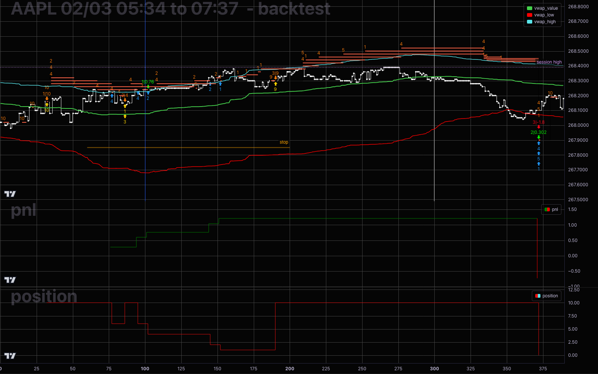

# backtest_plots

A React + Vite frontend for visualizing backtest results. Point it at any HTTP endpoint that returns the [JSON payload described below](#payload-schema) and it renders tick prices, indicator lines, order fills, and annotations on synchronized [lightweight-charts](https://github.com/tradingview/lightweight-charts) panes.



A fully interactive version of the chart above is checked in at [`tests/snapshots/expected.html`](tests/snapshots/expected.html). Download the raw file ([direct link](https://github.com/icanhazcodeplz/backtest-plots/raw/main/tests/snapshots/expected.html)) and open it in any browser. It's a self-contained bundle with the fixture data inlined, so you can pan, zoom, and inspect the panes without a backend or a build step.

## Quick start

Requires Node 22+.

```sh
npm install
npm run dev          # http://localhost:5173, loads data from http://127.0.0.1:5001/api/data
```

You don't need a backend to try it. Render the bundled fixture into a standalone HTML file and open it:

```sh
npm run snapshot tests/data/api_data.json /tmp/chart.html
open /tmp/chart.html
```

### Pointing at your own backend

The app fetches its payload once on load, from `http://127.0.0.1:5001/api/data` by default. Set `VITE_API_URL` to use another endpoint:

```sh
VITE_API_URL=http://localhost:8000/backtest npm run dev
```

The backend must allow cross-origin requests from the dev server's origin (CORS). For a quick check of the endpoint, run `npm run fetch-data` and then `npm run validate`.

## What it shows

- **Main pane**: the tick price line, with optional indicator overlays (`TickChartLines`), order durations as horizontal segments colored by side, fill dots and markers (`fill_markers`), vertical time markers (`VertLines`), and horizontal price levels (`HorizLines`).
- **Sub-panes**: up to two more panes below (`TickChart2Lines`, `TickChart3Lines`) for indicators such as P&L or position. Each point is colored by sign.
- **Watermarks and legends**: the payload `title` on the main pane, the indicator keys on each sub-pane, and a color legend in the corner of each pane that has lines.

All panes share a time scale and crosshair. Ticks are spaced evenly by index rather than by time, so gaps between irregular ticks don't render as empty space. Times are shown as `HH:MM:SS.nnnnnnnnn` in the browser's local timezone.

## Scripts

| Command | What it does |
|---|---|
| `npm run dev` | Vite dev server with hot reload |
| `npm run build` / `npm run preview` | Production build into `dist/`, and a local server for it |
| `npm run lint` | ESLint |
| `npm test` | Unit tests and the snapshot test (see [Testing](#testing)) |
| `npm run snapshot [data.json] [out.html]` | Build a single self-contained HTML file with a payload inlined. Defaults: `data/api_dumps/api_data.json` → `data/snapshots/snapshot.html` |
| `npm run snapshot:update` | Regenerate the snapshot test baseline |
| `npm run fetch-data [url] [out.json]` | Save the backend's response to disk (default `data/api_dumps/api_data.json`) |
| `npm run validate [data.json]` | Check a payload file against the schema and list anything the chart would skip |

`data/` is git-ignored, so it's a safe place for local dumps.

## Project layout

```
src/
  App.jsx                 Loads the payload (inlined snapshot data or fetch), then renders <Chart>
  config.js               API_URL (overridable with VITE_API_URL)
  components/
    Chart.jsx             Pane layout and chart lifecycle; no drawing logic
    LineLegend.jsx        Per-pane color legend
  chart/                  Everything that talks to lightweight-charts
    buildChart.js         Entry point: creates panes, draws overlays, syncs panes
    overlays.js           One draw function per payload field on the main pane
    series.js             Helpers for line series, indicator series, and segments
    panes.js              Creates one chart per pane with shared options
    sync.js               Keeps pane scrolling, zoom, and crosshair in step
    time.js               Nanosecond timestamp ↔ chart index mapping (pure)
    payload.js            Sub-pane selection and payload validation (pure)
    theme.js              All default colors and sizes
  plugins/                Custom lightweight-charts primitives (VertLine, HorizLineLabel)
scripts/                  snapshot, fetch-data, and validate CLIs
tests/
  unit/                   Unit tests for the pure modules in src/chart/
  snapshot.test.mjs       Rebuilds the snapshot and compares it with the baseline
  data/api_data.json      Fixture payload that exercises every field
  snapshots/expected.html Baseline for the snapshot test
```

### How drawing works

1. `App` loads the payload, logs any `validatePayload` problems to the console as warnings, and passes it to `Chart`.
2. `Chart` renders one `<div>` per pane, then calls `buildChart` with those containers.
3. `buildChart` builds a time index from `ticks`, creates the main chart, and calls each `draw*` function in `overlays.js`. It then creates the sub-pane charts and links all panes with `sync.js`.

**The index trick.** Chart x-coordinates are tick array indexes, not timestamps. Every payload field keyed by a timestamp (`fill_markers`, `orderDurations`, `HorizLines`, `VertLines`) is converted through the time index (`timeIndex.indexOf` / `nearestIndexOf`) before it reaches lightweight-charts. Mixing in raw timestamps puts items far off-screen.

### Common changes

- **Change a color or size**: edit `src/chart/theme.js`.
- **Draw a new payload field**:
  1. Add a `drawX(ctx)` function to `src/chart/overlays.js` and call it from `buildChart.js`.
  2. Add checks for the field to `validatePayload` in `src/chart/payload.js`, with a unit test.
  3. Add an example to `tests/data/api_data.json` and document the field below.
  4. Run `npm run snapshot:update` and commit the new baseline.
- **Add a sub-pane**: append the field name to `SUB_PANE_FIELDS` in `src/chart/payload.js`.

## Payload schema

The endpoint must return a JSON object with these fields. Timestamps are nanosecond Unix times as **decimal strings** (e.g. `"1770121507372223001"`), because nanosecond values overflow JavaScript numbers.

### Top-level

| Field | Type | Required | Description |
|---|---|---|---|
| `ticks` | `Tick[]` | yes | Price ticks in ascending time order; these drive every time axis |
| `fill_markers` | `FillMarker[]` | no | Markers attached to the fill dots |
| `TickChartLines` | `LineConfig[]` | no | Indicator lines overlaid on the main (price) pane |
| `TickChart2Lines` | `LineConfig[]` | no | Lines for the first sub-pane. The pane is drawn only if at least one tick has one of the keys |
| `TickChart3Lines` | `LineConfig[]` | no | Lines for the second sub-pane; same rule |
| `orderDurations` | `OrderDuration[]` | no | Horizontal segments showing how long each order was open |
| `HorizLines` | `HorizLine[]` | no | Horizontal price levels on the main pane |
| `VertLines` | `VertLine[]` | no | Vertical time markers on the main pane |
| `title` | `string \| string[]` | no | Watermark text on the main pane |

Unknown fields are ignored.

### `Tick`

| Field | Type | Required | Description |
|---|---|---|---|
| `time` | `string` | yes | Nanosecond timestamp |
| `price` | `number` | no | Trade price, plotted as the main price line. Omit it on ticks that only carry a `fill` |
| `fill` | `number` | no | Fill price at this tick, plotted as a dot |
| `size` | `number` | no | Trade size; not drawn |
| *any indicator key* | `number` | no | Values read by `TickChartLines`, `TickChart2Lines`, and `TickChart3Lines` through their `key` |

### `LineConfig`

| Field | Type | Required | Description |
|---|---|---|---|
| `key` | `string` | yes | Field name to read from each `Tick` |
| `color` | `string` | yes | CSS color for the line (for values ≥ 0 when `color_negative` is set) |
| `color_negative` | `string` | no | CSS color for values < 0. Used on sub-panes only |
| `type` | `number` | yes | lightweight-charts `LineType`: `0` = simple, `1` = stepped |
| `width` | `number` | yes | Line width in pixels |

### `FillMarker`

Passed through to lightweight-charts' `createSeriesMarkers`, with `time` converted to a chart index.

| Field | Type | Required | Description |
|---|---|---|---|
| `time` | `string` | yes | Nanosecond timestamp; must exactly match a `Tick.time` |
| `color` | `string` | yes | Marker color |
| `position` | `string` | yes | `"aboveBar"`, `"belowBar"`, or `"inBar"` |
| `price` | `number` | no | Not drawn; carried through to lightweight-charts |
| `shape` | `string` | yes | `"circle"`, `"square"`, `"arrowUp"`, or `"arrowDown"` |
| `text` | `string` | no | Label text next to the marker |
| `size` | `number` | no | Marker size multiplier |

### `OrderDuration`

| Field | Type | Required | Description |
|---|---|---|---|
| `start_time` | `string` | yes | Nanosecond timestamp; must exactly match a `Tick.time` |
| `end_time` | `string` | yes | Nanosecond timestamp; must exactly match a `Tick.time` |
| `price` | `number` | yes | Price level of the segment |
| `qty` | `number` | no | Order quantity; not drawn |
| `side` | `string` | yes | `"buy"` (yellow) or anything else (red-orange) |

### `HorizLine`

| Field | Type | Required | Description |
|---|---|---|---|
| `start_time` | `string` | yes | Nanosecond timestamp; must exactly match a `Tick.time` |
| `end_time` | `string` | yes | Nanosecond timestamp; must exactly match a `Tick.time` |
| `price` | `number` | yes | Price level of the line |
| `color` | `string` | no | CSS color for the line and its annotation (default `blue`) |
| `thickness` | `number` | no | Line width in pixels (default `2`) |
| `line_style` | `string` | no | `solid`, `dotted`, `dashed`, `large_dashed`, or `sparse_dotted` (default `solid`) |
| `opacity` | `number` | no | Alpha from `0` to `1`, applied to the line only. The annotation stays opaque |
| `annotation` | `string` | no | Label drawn above the right-hand end of the line |

### `VertLine`

| Field | Type | Required | Description |
|---|---|---|---|
| `time` | `string` | yes | Nanosecond timestamp; snaps to the nearest tick, so it need not match one exactly |
| `color` | `string` | no | CSS color for the line and its label (default `blue`) |
| `thickness` | `number` | no | Line width in pixels (default `1`) |
| `annotation` | `string` | no | Label on the time axis. The main pane's time axis is hidden when sub-panes are shown, so the label only appears when there are none |

Items whose timestamps don't match a tick are skipped rather than drawn. `npm run validate` and the browser console both list them.

## Testing

`npm test` runs two kinds of test with Node's built-in test runner:

- **Unit tests** (`tests/unit/`) cover timestamp formatting and lookup, sub-pane selection, and payload validation. They also check that the fixture is valid and uses every drawable field.
- **Snapshot test** (`tests/snapshot.test.mjs`) builds the self-contained HTML for `tests/data/api_data.json` and compares it byte-for-byte with `tests/snapshots/expected.html`. It catches any unintended change to the bundled app. Any intentional change to source, dependencies, build config, or the fixture also changes the output. After one, run `npm run snapshot:update` and commit the new baseline.

The snapshot test compares the bundle, not pixels. To check what the chart actually looks like, open `tests/snapshots/expected.html` in a browser.
